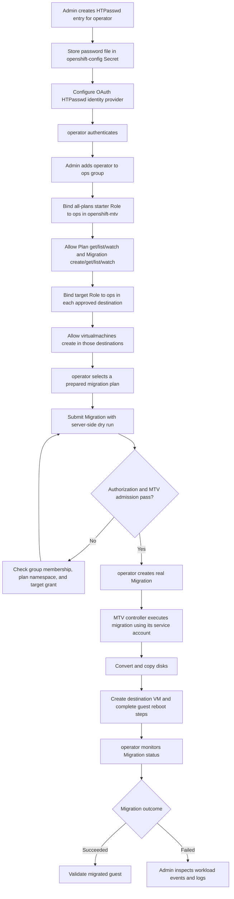

# HTPasswd operator and MTV migration permissions

Verified on luke, MTV 2.12.10, 2026-11-12. Plan: `openshift-mtv/windows-test-perms`; destination: `virt-windows`; source VM: `Windows2025` (`vm-46004`). This procedure starts an existing, administrator-prepared plan via the Kubernetes API, not the console plan editor.

## Process flow



This diagram uses the all-plans option in Step 3.7. Access remains namespace-scoped; each approved destination needs its own VM-creation grant.

## 1. Configure HTPasswd authentication

Follow [Red Hat's OpenShift 4.22 HTPasswd procedure](https://docs.redhat.com/en/documentation/openshift_container_platform/4.22/html/authentication_and_authorization/configuring-identity-providers#identity-provider-htpasswd-about_configuring-htpasswd-identity-provider). Red Hat recommends this only for development, not production.

As cluster administrator:

```bash
umask 077
# Install httpd-tools on RHEL, apache2-utils on Debian/Ubuntu.
# Interactive password entry avoids placing the password in shell history.
htpasswd -c -B users.htpasswd operator
oc create secret generic htpasswd -n openshift-config \
  --from-file=htpasswd=users.htpasswd
```

The cluster initially had no identity providers. Configure:

```yaml
apiVersion: config.openshift.io/v1
kind: OAuth
metadata:
  name: cluster
spec:
  identityProviders:
  - name: htpasswd
    mappingMethod: claim
    type: HTPasswd
    htpasswd:
      fileData:
        name: htpasswd
```

Apply this as `oc apply -f manifests/oauth.yaml`. On an existing installation, preserve other identity provider entries instead of replacing their array. Wait for `oc rollout status deployment/oauth-openshift -n openshift-authentication --timeout=180s` before testing authentication.

The setup performed here generated a bcrypt `$2a$` entry with Python bcrypt because `htpasswd` was unavailable. An initial `$2b$` entry failed with `Unrecognized hash type`; `$2a$` succeeded. The secret key is `htpasswd`; OAuth references `htpasswd.fileData.name`, not `htpasswd.file.name`. Passwords and hashes must not be committed.

```bash
# Use a separate kubeconfig so admin credentials/context remain unchanged.
oc --kubeconfig=operator.kubeconfig login \
  https://api.luke.syangsao.net:6443 -u operator
oc --kubeconfig=operator.kubeconfig whoami
# operator
```

For password changes, retrieve the current secret into a protected file, update with `htpasswd -B users.htpasswd operator` (without `-c`), then replace the secret:

```bash
oc get secret htpasswd -n openshift-config -o jsonpath='{.data.htpasswd}' \
  | base64 --decode > users.htpasswd
htpasswd -B users.htpasswd operator
oc create secret generic htpasswd -n openshift-config \
  --from-file=htpasswd=users.htpasswd --dry-run=client -o yaml \
  | oc replace -f -
rm users.htpasswd
```

## 2. Create the OpenShift group

HTPasswd authenticates users; it does not define groups. As administrator:

```bash
oc adm groups new ops operator
# For a group that already exists:
# oc adm groups add-users ops operator
oc get group ops -o jsonpath='{.users}{"\n"}'
# ["operator"]
```

## 3. Grant namespaced migration access

### 3.1. Confirm the identities, plan namespace, and destination

Run the administrative commands using your cluster-admin kubeconfig. Commands containing `--kubeconfig=operator.kubeconfig` deliberately use the unprivileged user instead. Do not grant these Roles to a service account named `operator`: the subject here is the OpenShift **Group** `ops`, containing the human User `operator`.

```bash
oc whoami
oc get group ops -o jsonpath='{.users}{"\n"}'
# Must include operator.
oc get plans.forklift.konveyor.io windows-test-perms -n openshift-mtv \
  -o jsonpath='{.metadata.namespace}{" -> "}{.spec.targetNamespace}{"\n"}'
# openshift-mtv -> virt-windows
oc get namespace openshift-mtv virt-windows
```

The namespaces and existing plan must already exist. If adapting this example, update the namespaces in **both** Role and RoleBinding metadata, the plan `resourceNames`, and the Migration manifest. The source provider and maps remain administrator-managed.

### 3.2. Understand the two independent grants

**Grant A — submit and monitor in `openshift-mtv`.** [ops-migration-rbac.yaml](manifests/ops-migration-rbac.yaml) creates Role `ops-migration-starter` and a same-named RoleBinding:

- `get` on the named Plan lets the operator review `windows-test-perms`.
- `create` on Migration objects is the action that starts the prepared plan; editing or recreating the Plan is not required.
- `get`, `list`, and `watch` on Migration objects allow status monitoring. These are convenience/observability permissions, separate from submission.
- The RoleBinding connects this Role to Group `ops` in this namespace only.

**Grant B — satisfy target authorization in `virt-windows`.** [ops-migration-target-rbac.yaml](manifests/ops-migration-target-rbac.yaml) creates Role `ops-migration-target` and its RoleBinding:

- The only rule is `create` on `virtualmachines` in API group `kubevirt.io`.
- MTV's Migration admission webhook checks whether the requesting user can create VMs in the plan's target namespace. Without this grant, Migration creation is rejected even though Grant A allows the API request.
- Binding this Role in `openshift-mtv` would not satisfy a check in `virt-windows`. The Role and RoleBinding must be in the destination namespace.

These are namespace-scoped **Roles**, not ClusterRoles. Each RoleBinding has `subjects.kind: Group`, `subjects.name: ops`, and `roleRef.kind: Role`. `roleRef.name` must match the Role in that RoleBinding's namespace.

### 3.3. Apply the manifests as administrator

```bash
# Inspect exactly what will be granted.
cat manifests/ops-migration-rbac.yaml
cat manifests/ops-migration-target-rbac.yaml

# Apply only the RBAC files, not the whole manifests directory.
oc apply -f manifests/ops-migration-rbac.yaml
oc apply -f manifests/ops-migration-target-rbac.yaml

# Read back rules and group subjects.
oc get role ops-migration-starter -n openshift-mtv -o yaml
oc get rolebinding ops-migration-starter -n openshift-mtv -o yaml
oc get role ops-migration-target -n virt-windows -o yaml
oc get rolebinding ops-migration-target -n virt-windows -o yaml
```

Each file contains two YAML documents separated by `---`: a Role and its RoleBinding. Applying the same files again reconciles those objects; it does not create another grant. Expected object names are `role/ops-migration-starter`, `rolebinding/ops-migration-starter`, `role/ops-migration-target`, and `rolebinding/ops-migration-target`.

### 3.4. Check effective access as the actual operator

```bash
oc --kubeconfig=operator.kubeconfig whoami
# operator
oc --kubeconfig=operator.kubeconfig auth can-i get \
  plans.forklift.konveyor.io/windows-test-perms -n openshift-mtv
# yes
oc --kubeconfig=operator.kubeconfig auth can-i create \
  migrations.forklift.konveyor.io -n openshift-mtv
# yes
oc --kubeconfig=operator.kubeconfig auth can-i list \
  migrations.forklift.konveyor.io -n openshift-mtv
# yes
oc --kubeconfig=operator.kubeconfig auth can-i watch \
  migrations.forklift.konveyor.io -n openshift-mtv
# yes
oc --kubeconfig=operator.kubeconfig auth can-i create \
  virtualmachines.kubevirt.io -n virt-windows
# yes

# These operations are deliberately not granted by these manifests.
oc --kubeconfig=operator.kubeconfig auth can-i get secrets -n openshift-mtv
# no
oc --kubeconfig=operator.kubeconfig auth can-i patch \
  plans.forklift.konveyor.io/windows-test-perms -n openshift-mtv
# no
oc --kubeconfig=operator.kubeconfig auth can-i create pods -n virt-windows
# no
```

The comments describe expected access for an otherwise unprivileged operator. RBAC permissions are additive: unrelated bindings can make a negative check return `yes`. A `no` result normally exits nonzero; this is expected, not a command failure to fix with broader grants.

`auth can-i` checks authorization only. Continue to Step 4's **server-side dry run**, which also exercises MTV admission without creating a persistent Migration or powering off a VM.

### 3.5. Permission summary and security boundaries

| Namespace | Role / RoleBinding | Resources | Verbs | Purpose |
|---|---|---|---|---|
| openshift-mtv | ops-migration-starter | plans.forklift.konveyor.io, resourceNames: windows-test-perms | get | Read the prepared plan |
| openshift-mtv | ops-migration-starter | migrations.forklift.konveyor.io | create | Submit migration |
| openshift-mtv | ops-migration-starter | migrations.forklift.konveyor.io | get, list, watch | Monitor migrations |
| virt-windows | ops-migration-target | virtualmachines.kubevirt.io | create | Pass MTV migration admission authorization |

Both RoleBindings target Group `ops`. No cluster-admin, namespace edit/admin, provider-secret access, target pod/PVC creation or SCC grant was added. The controller performs migration work with its own credentials.

**Important scope limitation:** Kubernetes RBAC cannot restrict `create migrations` by `spec.plan.name` or by `resourceNames`. This grant can submit migrations for other plans in `openshift-mtv` where admission checks permit them. `get` on the plan is name-restricted, but that does not restrict migration submission. Strict single-plan enforcement requires an additional admission policy or namespace isolation. Target `create virtualmachines` also permits direct VM creation in `virt-windows`. Monitoring grants expose other Migration objects in `openshift-mtv`. These are not single-plan-only permissions.

### 3.6. Diagnose a failed access check

- **Migration create says `no`:** check that `operator` is in Group `ops`, the starter RoleBinding is in `openshift-mtv`, and its `roleRef` names `ops-migration-starter`.
- **Dry run says the user cannot create `virtualmachines`:** check the plan's actual `spec.targetNamespace` and apply/bind the target Role in that namespace. Do not fix this with `cluster-admin`.
- **Named plan read fails but migration create works:** inspect the starter Role's `resourceNames`. This example grants `get` for `windows-test-perms`, not `list plans` or access to every plan.
- **`oc get pods`, VM reads, or logs are forbidden for operator:** expected with this start-and-monitor profile. Use administrator credentials for workload diagnostics; additional read/log permissions are a separate requirement.
- **Console navigation is incomplete:** this API-focused profile does not promise console inventory browsing, provider editing, map editing, or VM management. Do not treat console requirements as proof that API migration submission needs namespace `edit`.

To revoke these particular grants, an administrator can delete the two RoleBindings:

```bash
oc delete rolebinding ops-migration-starter -n openshift-mtv
oc delete rolebinding ops-migration-target -n virt-windows
```

Revocation does not cancel an already-submitted migration: the controller continues under its own service account. Other RoleBindings, if present, can still grant access.

### 3.7. Alternative: access to all migration plans

**Scope:** all existing and future Plans in `openshift-mtv`, not every namespace in the cluster. This remains a start-and-monitor profile; it does not grant Plan creation, editing, deletion, or provider-secret access.

Use [ops-migration-all-plans-rbac.yaml](manifests/ops-migration-all-plans-rbac.yaml) **instead of** the single-plan starter manifest in Step 3.3:

```bash
# Administrator: replace the existing starter Role's rules.
oc apply -f manifests/ops-migration-all-plans-rbac.yaml
oc get role ops-migration-starter -n openshift-mtv -o yaml
```

The alternative deliberately uses the **same Role and RoleBinding names** as the single-plan version, so it updates the existing grant rather than adding a second convention. The Plan rule becomes:

```yaml
- apiGroups: [forklift.konveyor.io]
  resources: [plans]
  verbs: [get, list, watch]
```

Removing `resourceNames` allows reads of any Plan; adding `list` and `watch` allows discovery and monitoring of all Plans in that namespace. Migration permissions stay `create, get, list, watch`: they were already namespace-wide. The original manifest never enforced single-plan-only submission (see Step 3.5).

#### Grant access to each permitted destination namespace

The target VM `create` check still applies independently for every plan. The existing target manifest covers only `virt-windows`. As administrator, inventory the plans and destinations first:

```bash
oc get plans.forklift.konveyor.io -n openshift-mtv \
  -o custom-columns=PLAN:.metadata.name,TARGET_NAMESPACE:.spec.targetNamespace
```

For plans targeting `virt-windows`, retain the existing target RoleBinding:

```bash
oc apply -f manifests/ops-migration-target-rbac.yaml
```

For each additional approved destination, create the same target Role and RoleBinding there. For example, set `TARGET_NS` to an existing approved namespace and run:

```bash
TARGET_NS=virt-linux
oc get namespace "$TARGET_NS"
oc create role ops-migration-target --namespace="$TARGET_NS" \
  --verb=create --resource=virtualmachines.kubevirt.io \
  --dry-run=client -o yaml | oc apply -f -
oc create rolebinding ops-migration-target --namespace="$TARGET_NS" \
  --role=ops-migration-target --group=ops \
  --dry-run=client -o yaml | oc apply -f -
```

Repeat for each approved destination. Do not automatically grant VM creation in every namespace: this permission also allows direct VM creation. Newly added Plans in `openshift-mtv` are readable immediately, but a new destination requires its own grant. Plans with different providers or options should each receive a server-side admission dry run; the real migration test in this guide covered only `windows-test-perms`.

#### Verify as operator before starting another plan

```bash
oc --kubeconfig=operator.kubeconfig auth can-i list \
  plans.forklift.konveyor.io -n openshift-mtv
# Expected: yes after applying the alternative.
oc --kubeconfig=operator.kubeconfig get plans.forklift.konveyor.io -n openshift-mtv
oc --kubeconfig=operator.kubeconfig auth can-i create \
  migrations.forklift.konveyor.io -n openshift-mtv
# Expected: yes.
oc --kubeconfig=operator.kubeconfig auth can-i create \
  virtualmachines.kubevirt.io -n "$TARGET_NS"
# Expected: yes for each explicitly granted target.
```

For another prepared Plan, create a copy of `manifests/migration.yaml`, replace `spec.plan.name` and the name prefix, and keep the correct plan namespace. Run `oc --kubeconfig=operator.kubeconfig create --dry-run=server -f <your-migration.yaml>` first. Only omit `--dry-run=server` when intentionally starting that migration.

#### Plans in additional namespaces

The RoleBinding above does not cover Plans outside `openshift-mtv`. For each approved plan namespace, deploy a copy of the all-plans manifest with **both** Role and RoleBinding `metadata.namespace` changed to that namespace, plus target grants for its approved destinations. This explicit namespace allowlist avoids cluster-wide access. Do not use `oc get plans -A` as a success criterion for namespaced grants: listing across all namespaces requires cluster-wide authorization.

#### Return to named-plan read access

```bash
oc apply -f manifests/ops-migration-rbac.yaml
```

This restores the original Plan `resourceNames` restriction and removes Plan `list/watch` from this Role. It does not restrict Migration `create` to one plan, and it does not revoke target RoleBindings added in other namespaces; delete those bindings separately if no longer approved. Do not apply both starter variants together: whichever is applied last defines the shared Role's rules.

This alternative is documented and its manifest is validated without persistence; it was **not applied to the live cluster** as part of this documentation update.


## 4. Verify admission without starting a migration

Before the grants, `operator` could not create migrations. With only the starter RoleBinding, server-side dry run was rejected by the MTV webhook:

```text
Action is forbidden: User "operator" cannot create resource "virtualmachines" in API group "kubevirt.io" in the namespace "virt-windows"
```

After adding only target VM `create`, the same dry run passed. The test also passed using the real authenticated operator context, not just impersonation:

```bash
cat <<'EOF' | oc --kubeconfig=operator.kubeconfig create --dry-run=server -f -
apiVersion: forklift.konveyor.io/v1beta1
kind: Migration
metadata:
  generateName: windows-test-perms-
  namespace: openshift-mtv
spec:
  plan:
    name: windows-test-perms
    namespace: openshift-mtv
EOF
# migration.forklift.konveyor.io/windows-test-perms-vxhtb created (server dry run)
```

Administrator negative check:

```bash
oc --as=operator --as-group=ops auth can-i get secrets -n openshift-mtv
# no
```

Dry run proves API authorization and current MTV admission acceptance, not successful disk transfer or console usability. No actual migration was started by these tests. No provider/map/storage/NAD read grants were needed for this API submission path. Console browsing/editing is a different workflow and was not tested.

## 5. Start and monitor when ready

Remove `--dry-run=server` from the preceding `oc create` command to actually start migration. Cold migration can power off the source VM; review the plan before doing so.

```bash
oc --kubeconfig=operator.kubeconfig get plans.forklift.konveyor.io \
  windows-test-perms -n openshift-mtv -o yaml
oc --kubeconfig=operator.kubeconfig get migrations.forklift.konveyor.io \
  -n openshift-mtv -w
```

The plan was Ready, with warnings for automatic target-name normalization and missing VMware guest IP information. Successful admission does not resolve those warnings or prove migration completion.

## 6. Actual migration test as operator

On 2026-11-12, authenticated `operator` (member of `ops`) created a real Migration, without impersonation or additional grants:

```bash
oc --context=openshift-virtualization-os-images/api-luke-syangsao-net:6443/operator whoami
# operator
cat <<'EOF' | oc --context=openshift-virtualization-os-images/api-luke-syangsao-net:6443/operator create -f -
apiVersion: forklift.konveyor.io/v1beta1
kind: Migration
metadata:
  generateName: windows-test-perms-ops-
  namespace: openshift-mtv
spec:
  plan:
    name: windows-test-perms
    namespace: openshift-mtv
EOF
# migration.forklift.konveyor.io/windows-test-perms-ops-mfg6k created
```

The same operator context could read Migration progress. Administrator credentials were used only to inspect target pods, VM state, and controller logs; they were not used to submit the migration.

| Milestone | Observed UTC time |
|---|---|
| Migration started | 21:50:26 |
| Disk allocation completed | 21:50:52 |
| Image conversion completed | 21:52:42 |
| Disk transfer completed (102400/102400 MB) | 22:05:41 |
| Target VM creation completed | 22:05:44 |

Target VM `virt-windows/windows2025` was observed Running. The conversion container exited 0 with no restarts. No `forbidden` or `permission denied` messages appeared in the checked controller log window. No permissions were added during the real test.

The user subsequently reported completion. The API snapshot captured at that point still showed `Running` / `WaitForGuestReboots`, rather than a terminal `Succeeded` condition. These are distinct observations: operator submission, disk transfer, and target VM creation are verified; terminal success was not yet established by that snapshot. Guest application functionality and console-user workflows were not tested.

Conclusion: the documented group RoleBindings permit this existing-plan API migration workflow, including real submission and controller execution through target VM creation. A Windows reboot wait is not evidence of missing operator permissions.

## 7. Repository quick reference

Run the setup commands above from this repository root. `manifests/oauth.yaml` configures authentication; it does not contain credentials. The two RBAC manifests grant access to Group `ops`.

After setup, use `oc --kubeconfig=operator.kubeconfig create --dry-run=server -f manifests/migration.yaml` for admission testing. To actually migrate, omit `--dry-run=server`. Do not apply all manifests together: a Migration submission is an intentional, separate operation.

Keep `operator.kubeconfig` and local password files outside version control.
